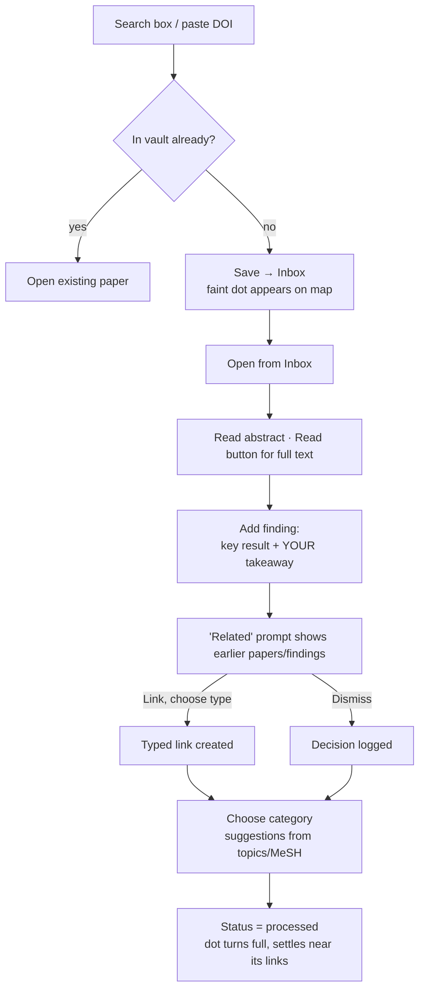

# 02 · Features & flows

Each feature has an ID, its phase, and **"done when"** criteria written so a developer — or an AI agent — can build and check it without re-asking. Details live in the linked docs.

## Feature list

### Phase 1 — Desktop vault (Milestone M1 "it remembers for me")

**F-01 Merged search** *(D29, [06](06-sources-and-search.md))*
- One search box queries PubMed, Europe PMC and OpenAlex in parallel.
- Results are merged so each paper appears once; source chips narrow to one source.
- Each result shows title, authors (first 3 + "et al."), journal, year, and evidence labels.
- Results already in your vault are marked ("in vault · processed" / "in vault · inbox").
- *Done when:* a query that hits the same paper in all three sources shows it once; a source failing (offline, error) shows a non-blocking notice and results from the others; results appear progressively.

**F-02 "Open in Google Scholar"** *(D29)*
- A button that opens the current query in the system browser at Google Scholar. No scraping.
- *Done when:* clicking opens `https://scholar.google.com/scholar?q=<encoded query>` in the default browser.

**F-03 Add by identifier / manual entry** *(D28)*
- Paste a DOI, PubMed ID, PMC ID or URL containing one → details are fetched and the paper goes to the Inbox.
- No identifier → manual entry form; paper is marked **"details unverified"**.
- *Done when:* DOI, PMID, PMCID, `doi.org/…` and `pubmed.ncbi.nlm.nih.gov/…` URLs all resolve; duplicates of an existing vault paper open the existing one instead of creating a copy.

**F-04 Save → Inbox → Process** *(D59)*
- Saving puts a paper in the Inbox (status `inbox`).
- Processing = adding ≥1 finding with a non-empty takeaway + choosing ≥1 category → status `processed`.
- Optional at save: "found via" note or link (e.g. the Reddit thread / podcast episode) as an attachment.
- *Done when:* status changes automatically when both conditions are met and back to `inbox` if either is removed; Inbox count is visible on desktop and phone.

**F-05 Paper page** *(D24, D26)*
- Abstract, full details, evidence labels, identifiers, categories, findings, links, attachments.
- **Read** button: opens the best free copy (Unpaywall) if one exists, otherwise the publisher/DOI page, in the system browser.
- Trial registration numbers mentioned in metadata are shown with a link out to ClinicalTrials.gov (D23).
- You can correct any evidence label by hand; corrected labels are marked "edited by you" (my call — heuristics will sometimes be wrong).
- *Done when:* every label shows a value or an explicit "unknown"/"n/a"; Read never opens a paywalled page when a free legal copy is known.

**F-06 Findings & takeaways** *(D21, D41, D67)*
- A paper holds 1..n findings. A finding is an ordered **stack of blocks**: `key_result` (objective), `takeaway` (yours, required for "processed"), optional `note` blocks. (Sketch blocks arrive in P3 — the block structure exists from day one.)
- *Done when:* blocks can be added, reordered and deleted; no AI ever writes into a takeaway block (enforced in the core, not just the UI).

**F-07 Typed links** *(D21, D35)*
- Link any two of: paper, finding, lead. Types: **supports →**, **extends →** (one-way); **contradicts ↔**, **same mechanism ↔**, **related ↔** (two-way). Optional note.
- *Done when:* a link can be created from the paper page, from the "related" prompt, and by dragging between dots on the map; a link between findings is visible on both papers' pages.

**F-08 Leads & attachments** *(D20, D27)*
- Attachments: URL or screenshot (image file), attached to a paper, finding or lead.
- Lead: a standalone claim or link ("podcast: X affects Y — find the source"), status `open` → `resolved` when you link a paper/finding to it.
- *Done when:* leads appear on the map with their own shape and no evidence labels; resolving fades them (D36).

**F-09 Nested categories with suggestions** *(D30, D31)*
- Your own tree (any depth), several categories per paper.
- Suggestions from OpenAlex topics and MeSH terms; accept / rename / ignore in one action.
- Suggestions **learn**: once you map a topic/term to your category, future papers with it are pre-suggested there.
- *Done when:* nothing is ever assigned without your confirmation; a move that would put a category inside its own descendant is refused.

**F-10 Vault search** *(D39)*
- Keyword search (titles, abstracts, findings, takeaways, notes, lead text) and meaning search (fingerprints).
- *Done when:* "muscle recovery" finds a saved paper about post-exercise soreness that never uses those words; results show which field matched.

**F-11 "Related" prompt** *(D12, D39, D59, D66, [08](08-ml.md))*
- On save: a short hint ("you already have 3 related papers"). While processing: the full prompt with the top related papers/findings already in your vault, each with a one-line "why" (similar meaning · same category · cites it · shared author).
- Each suggestion: **Link** (choose type) or **Dismiss**. Every decision is logged with a snapshot of its features (D66).
- *Done when:* suggestions appear in under 1 second on desktop for a 1,000-paper vault; decisions are logged even when you just close the prompt ("ignored").

**F-12 The map** *(D32, D33, D58, D72, D73, [07](07-map-and-interface.md))*
- Desktop home screen. Global view; tap/click a dot for **focus mode** (its neighborhood); category filter.
- Layers: base (papers + your links, colored by category), findings, leads. (Suggestion and keyword-hub layers come in P3.)
- Stable positions saved and synced; new dots settle near what they link to; drag to pin; **Tidy up** re-runs layout.
- Faint dots = Inbox papers; full dots = processed.
- *Done when:* 1,000 dots + 3,000 links pan and zoom smoothly on desktop; positions survive restart; Tidy up keeps pinned dots in place.

**F-13 Trash** *(D53)*
- Deleted papers, findings, links, leads, categories go to Trash for 30 days, restorable.
- *Done when:* restore brings back the item with its links; items are purged automatically after 30 days.

**F-14 Manual export** *(D53)*
- **JSON** (complete; can rebuild a vault), **Markdown** with `[[links]]` (one file per paper, Obsidian-friendly), **BibTeX/RIS** (papers only, Zotero-friendly).
- *Done when:* a JSON export imported into an empty vault reproduces it exactly (round-trip test).

**F-15 Stats** *(D78)*
- Settings → Stats: share processed, links per processed paper, suggestion acceptance rate. (Sync health added in P2.)

**F-16 Settings & first run** *(D49, D65)* — my call
- First launch: research-only notice; enter contact email (used for NCBI/Crossref/Unpaywall etiquette) and API keys (OpenAlex required, NCBI optional). Keys stored in settings, never in code.

### Phase 2 — Android + sync (Milestone M2 "one vault, two devices")

**F-20 Android app** *(D44, D58)* — Same features as desktop; home = Inbox; tabs Inbox · Search · Map · Vault. Map on phone: dots + colors, labels on zoom, tap for focus mode (D33).
- **Receive shares** from other apps (D18): a URL shared from the browser or a podcast app → if it contains a paper identifier, add by identifier (F-03); otherwise offer "New lead with this link". Needs an Android share-target intent — likely a small Kotlin plugin (verify early in P2).
- *Done when:* every P1 feature works on the phone; sharing a PubMed URL from Chrome lands the paper in the Inbox in two taps.

**F-21 Pairing** *(D51, [05](05-sync-spec.md))* — Desktop shows a QR code; phone scans it; devices exchange keys once. Fallback: type the address.

**F-22 Sync** *(D45, D46, D69)* — Automatic when both devices are on the same network; manual "Sync now". Merge rules per [05](05-sync-spec.md).
- *Done when:* the sync simulator passes; a week of real daily use on both devices produces zero lost or duplicated edits (M2 test).

**F-23 Conflict resolution** *(D51)* — If the same takeaway/note was edited on both devices before syncing, both versions are kept and you pick or merge them.

**F-24 Version check** *(D75)* — Devices refuse to sync across incompatible versions with "update the other device first".

**F-25 Sync health in Stats** — last sync, ops exchanged, conflicts open.

### Phase 3 — "Next" (in this order, D77)

| # | Feature | Summary | Ref |
|---|---|---|---|
| F-30 | **Timelapse** | Button on the map: replays the map's growth in creation order at current positions, faint→full as papers got processed; play/pause, speed, scrubber | D74, [07](07-map-and-interface.md) |
| F-31 | **Topic feed with "why"** | Followed searches/topics/authors; new papers ranked by relation to your vault; each shows why; peer-reviewed-only by default | D38, D24 |
| F-32 | **Retraction alerts** | Saved papers periodically re-checked (Crossref/Retraction Watch, PubMed, withdrawn preprints); loud banner when status changes | D24, D25 |
| F-33 | **Suggestion layer + keyword hubs** | Dashed citation/similarity suggestions on the map, visibly separate from your links; optional keyword hub layer | D32 |
| F-34 | **Your own link model** | Replaces the hand-tuned "related" score once it beats it on held-out decisions | D66, D70, [08](08-ml.md) |
| F-35 | **Sketching** | Sketch blocks in findings: freehand + drawing over screenshots; finger on phone, mouse on desktop; notes only | D67, D75 |
| F-36 | **In-app reader + own PDFs** | Read open-access full text in the app; attach your own PDFs to any paper | D26 |
| F-37 | **Bring-your-own-model connector** | One OpenAI-compatible setting; enables optional AI features (e.g. sample-size extraction), all off by default | D48 |

### Phase 4 — "Later" (parked, D56)
Path view ("how does A connect to B?"), timeline layout, ClinicalTrials.gov as a searchable source, custom link types, highlight-to-finding in PDFs.

## Main user flows

### Flow 1 — Find, save, process



### Flow 2 — From a lead to a paper
1. Hear a claim on a podcast → on the phone, **New lead**: "X improves Y — find source", attach the episode link.
2. Later at the desk, search for it; save the paper; process it.
3. Link the paper's finding to the lead (*supports* or *contradicts*). The lead resolves and fades.

### Flow 3 — Exploring the map
Open the app (desktop) → global map → filter to a category → click a dot → focus mode shows its neighborhood → click a link to see its note → open the paper panel → jump to a linked finding.

### Flow 4 — Pairing and syncing (P2)
Desktop: Settings → Devices → **Pair a phone** shows a QR. Phone: **Pair with desktop** → scan → both confirm the same 6-digit code → paired. From then on, whenever both are on the home network they sync automatically; a small sync indicator shows status.

### Flow 5 — Timelapse (P3)
Map → **Timelapse** → the map empties and replays: dots appear as they were saved, fill in as they were processed, links draw as they were made. Scrub to any date.

## Screens

```
DESKTOP — home = map
┌──────────────┬──────────────────────────────────────┬───────────────────┐
│ 🔍 Search    │                                      │ Paper panel       │
│ 📥 Inbox (3) │            GLOBAL MAP                │ (opens on click)  │
│ 🗂 Categories│                         [Layers ▾]   │ Title · labels    │
│   › Neuro…   │      ●──supports──▶●                 │ Findings (2)      │
│     › BDNF   │         ╲                            │ Links (4)         │
│   › Kines…   │          ◌ (inbox)   ◇ lead          │ Attachments       │
│ ⚙ Settings  │              [Tidy up] [Timelapse P3]│ [Read] [Process]  │
└──────────────┴──────────────────────────────────────┴───────────────────┘

PHONE — home = Inbox
┌─────────────────────────┐
│ Inbox (3)        [+ Lead]│
│ ◌ Paper title…   Process │
│ ◌ Paper title…   Process │
│ ◌ Paper title…   Process │
│                         │
├─────────────────────────┤
│ 📥 Inbox 🔍 Search 🕸 Map 📚 Vault │
└─────────────────────────┘
```

Visual identity is deliberately open (D60) — see the design brief in [07](07-map-and-interface.md#design-brief).
