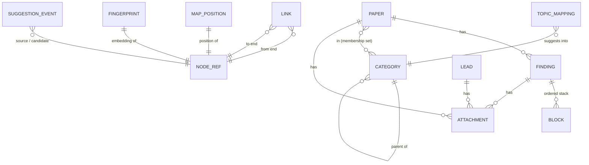

# 03 · Data model

Stored in **SQLite** on each device, owned by the Rust core (D71). Every synced entity follows the same base rules so the sync engine ([05](05-sync-spec.md)) can treat them uniformly.

## Base rules for every synced entity

| Rule | Why |
|---|---|
| **IDs are UUIDv7**, generated on the device that creates the entity | Unique without coordination; time-ordered (my call) |
| `created_at`, `updated_at` = hybrid logical clock (HLC) values | Ordering across devices (D69); enables timelapse (D37, D74) |
| `created_by_device` | Debugging, sync health |
| **Soft delete:** `deleted_at` (null = alive) | 30-day Trash (D53); purge after 30 days |
| No entity is ever overwritten wholesale — changes are field-level operations | Merge rules work per field (D51) |
| `owner_id` column present but constant for now | Door open to multiple users at zero cost (D7) |

## Entity-relationship overview

`NODE_REF` = a reference to a paper, finding or lead: `(kind, id)`.

## Entities

### Paper
| Field | Type | Notes |
|---|---|---|
| id | uuid | |
| doi, pmid, pmcid, openalex_id | text, nullable | Identity keys, normalized (lowercase DOI, no prefix) — see identity merge in [06](06-sources-and-search.md) |
| title, abstract | text | |
| authors | json | `[{name, orcid?}]` |
| journal, year, pub_date | text/int | |
| pub_types | json | Raw publication types from sources |
| mesh_terms | json | Raw MeSH headings incl. check tags |
| openalex_topics | json | `[{id, name, subfield, field, domain, score}]` |
| referenced_works | json | OpenAlex IDs of references (for citation signals) |
| label_study_type | enum | `rct, meta_analysis, systematic_review, clinical_trial, observational, case_report, review, preprint_other, other, unknown` |
| label_species | enum | `human, animal, in_vitro, mixed, unknown` |
| label_peer_review | enum | `peer_reviewed, preprint, unknown` |
| label_retraction | enum | `none, retracted, correction, expression_of_concern, withdrawn_preprint, unknown` |
| label_sample_size | int, nullable | Only via BYO model (P3); else shown "n/a" (F11) |
| trial_ids | json | NCT numbers found in metadata |
| best_oa_url | text, nullable | From Unpaywall |
| details_verified | bool | false for manual entries (D28) |
| status | enum | `inbox, processed` — **derived** (see below), stored for speed |
| sources | json | Which sources returned it |
| created_at / updated_at / deleted_at | hlc | |

**Derived status:** `processed` ⇔ ≥1 live finding with a non-empty takeaway block **and** ≥1 live category membership. Recomputed on every relevant change on each device (deterministic → no sync conflict).

### Finding
| Field | Type | Notes |
|---|---|---|
| id, paper_id | uuid | |
| order | fractional index (text) | Ordering among a paper's findings without renumbering (my call) |
| created/updated/deleted | hlc | |

### Block (finding content)
| Field | Type | Notes |
|---|---|---|
| id, finding_id | uuid | |
| kind | enum | `key_result, takeaway, note, sketch` (sketch in P3) |
| order | fractional index | |
| text | text | For text kinds |
| sketch | json, nullable | P3: `{strokes:[{points:[[x,y,pressure]...], color, width}], background_attachment_id?}` |
| base_version | op id | The version this edit was based on — used for text conflict detection ([05](05-sync-spec.md)) |
| ai_generated | bool | Must be **false** for `takeaway` — enforced in core (D41) |

Rule: exactly one `takeaway` and at most one `key_result` per finding (my call); any number of `note`/`sketch` blocks.

### Link
| Field | Type | Notes |
|---|---|---|
| id | uuid | |
| from_kind, from_id, to_kind, to_id | enum, uuid | kind ∈ paper, finding, lead |
| type | enum | `supports, extends, contradicts, same_mechanism, related` |
| directed | bool | derived from type: true for supports/extends |
| note | text | optional |
| origin | enum | `manual, from_suggestion` |
| suggestion_event_id | uuid, nullable | when created from a suggestion |

Two-way types are stored once; the pair is normalized (lower id first) to avoid duplicates.

### Lead
| id, text (the claim), status (`open, resolved`), resolved_at |

A lead resolves automatically when a link to it is created from a paper or finding; you can re-open it.

### Attachment
| id, owner_kind, owner_id, kind (`url, image, pdf`(P3)), url, blob_hash, caption |

Binary content (screenshots, later PDFs) is stored as files named by content hash (SHA-256) in the app data folder; the database holds the hash. Blobs sync separately by hash ([05](05-sync-spec.md)).

### Category & membership
- **Category:** id, name, parent_id (nullable = root), color (optional, for the theme), order.
- **Membership:** `(paper_id, category_id)` with add/remove operations (observed-remove set semantics, [05](05-sync-spec.md)).

### Topic mapping (learned suggestions, D31)
| source (`openalex_topic`, `mesh`), source_key, category_id, times_used |

### Map position (D73)
| node_kind, node_id, x, y, pinned (bool) | Synced; written only when layout settles or you drag (not every animation frame).

### Fingerprint (D39, D52, D61)
| node_kind, node_id, model_id, variant (`proximity`, `adhoc_query`), content_hash, vector (blob, 768 × f32 or f16) |

Keyed by `(node, model_id, content_hash)`: if both devices compute the same fingerprint, they're identical and deduplicate. Changing the model means recomputing all (F20).

### Suggestion event (D66) — append-only
| Field | Notes |
|---|---|
| id, at (hlc), device | |
| context | `processing, on_save, map_suggestion, feed` |
| source_kind/id, candidate_kind/id | |
| features | json snapshot **at decision time**: cosine similarity, shared categories, topic/MeSH overlap, citation relation, shared authors, year gap, etc. |
| score, scorer_version | which scoring (hand-tuned v1 or model vN) produced it |
| rank | position shown |
| decision | `linked(type), dismissed, ignored` |

Snapshotting features at decision time is what makes later training honest (no leakage from data that changed afterwards).

### Followed item (P3 feed)
| id, kind (`query, topic, author`), value, filters (json) |

### Settings
- **Synced:** contact email, followed items (P3), feed filters, theme choice.
- **Device-local:** API keys (my call: local, entered per device — keeps secrets off the wire), paired devices, window state.

### Device-local tables (not synced)
`devices` (paired peers: id, name, public key, last_seen) · `op_log` and `version_vector` ([05](05-sync-spec.md)) · `api_cache` (responses with TTL) · `trash_purge_queue`.

## Size check at target scale (D34)
~1,000 papers, ~2,000 findings, ~5,000 blocks, ~3,000 links → well under 50 MB of database including fingerprints (≈3 KB each at f32). Screenshots dominate storage, not data.
