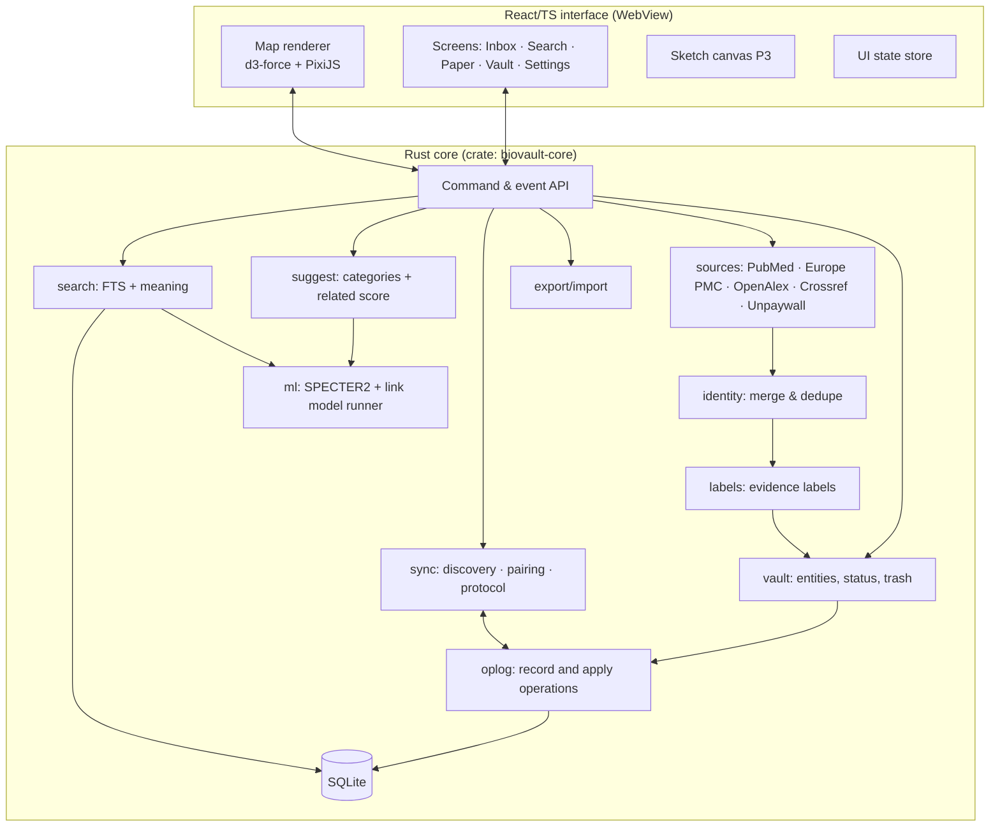

# 04 · Architecture

## Stack (D68, D70, D71, D72)

| Layer | Choice | Why |
|---|---|---|
| App shell | **Tauri 2** (Windows + Android from one project) | One codebase; small, fast desktop app; Rust core shared across devices |
| Core | **Rust** | Written once for both devices: storage, sources, search, sync, ML inference |
| Interface | **React + TypeScript** | Familiar from previous Electron/React work; richest ecosystem for graph and canvas work |
| Database | **SQLite** (bundled) + built-in full-text search (FTS5) | Embedded, reliable, identical on both devices |
| Meaning search | In-memory vector comparison in Rust | ~1,000–3,000 fingerprints: microseconds; no vector DB needed |
| Embeddings | **SPECTER2** as ONNX, 8-bit, run in the Rust core | Paper-specialized; English; Apache-2.0 (D61) |
| Inference engine | **ONNX Runtime via `ort`** | Builds for Windows and Android from prebuilt libraries; 0.29 s per abstract on the phone. Pure-Rust `tract` was 33 s on the int8 model (D84) |
| Map | **d3-force** (layout) + **PixiJS** (drawing) | Full visual control; MIT licenses (D72) |
| Sketching (P3) | Own canvas + **perfect-freehand** | Light, MIT, strokes as point lists (D75) |
| Sync | **Own engine**: op log + hybrid logical clocks | Matches the merge rules exactly (D69) |
| Link model training | **Python** on desktop → exported model file | Familiar, fast experimentation (D70) |

**Dependency license policy (D63):** MIT, Apache-2.0, BSD, ISC, Zlib, MPL-2.0 (file-level) are fine with attribution. **No GPL/AGPL** — they conflict with all-rights-reserved distribution. Check every new dependency.

## Big picture



## The rule that protects the project: the core doesn't know about the UI

- `biovault-core` is a plain Rust library with **no Tauri dependency**. A thin `biovault-tauri` crate exposes it as Tauri commands/events.
- If Tauri's Android side disappoints, swap the interface for Flutter via flutter_rust_bridge; the core — most of the hard work — carries over unchanged (D68).
- Everything that changes data goes through `vault` → `oplog`. The UI never writes to the database directly. That single path is what makes sync trustworthy.

## Core modules

| Module | Responsibility | Key interfaces |
|---|---|---|
| `vault` | Create/update/delete entities; derive paper status; trash & purge; enforce rules (no AI takeaways, category cycles) | `save_paper`, `add_finding`, `edit_block`, `create_link`, `assign_category`, `delete`, `restore` |
| `oplog` | Turn every mutation into an operation with an HLC stamp; apply local and remote ops deterministically | `record(op)`, `apply(ops)`, `ops_since(version_vector)` |
| `sources` | One client per API, rate-limited, cached, polite (email/tool parameters) | `search(query) -> stream<Result>`, `lookup(identifier)` |
| `identity` | Normalize identifiers; merge results from several sources into one paper | `merge(results) -> papers` |
| `labels` | Derive evidence labels from source metadata | `derive(paper) -> labels` |
| `search` | Keyword (FTS5) and meaning search over the vault | `search_vault(query, mode)` |
| `ml` | Load SPECTER2 variants; compute fingerprints; run the related score (hand-tuned v1, later your model) | `fingerprint(text, variant)`, `related(node, k)` |
| `suggest` | Category suggestions (topics/MeSH + learned mappings); related suggestions; log decisions | `suggest_categories(paper)`, `suggest_related(node)`, `log_decision` |
| `sync` | Discovery, pairing, sessions, protocol, blob transfer, version checks | see [05](05-sync-spec.md) |
| `export` | JSON (full), Markdown, BibTeX/RIS; JSON import | `export(format, path)`, `import_json(path)` |

## Core ↔ interface boundary

- **Commands** (UI → core): request/response, typed with shared TypeScript types generated from Rust (e.g. with `ts-rs` or `specta`, my call).
- **Events** (core → UI): `vault_changed {entities}`, `search_results {batch}`, `sync_status`, `suggestions_ready`. The UI re-queries what it shows; it never assumes.
- Long jobs (fingerprinting, sync, search fan-out) run on background threads in the core; the UI shows progress from events.

## Platform specifics

| Concern | Windows | Android |
|---|---|---|
| App data location | Tauri app data dir | App-private storage |
| Network discovery | mDNS works directly | Needs a `WifiManager.MulticastLock` — a small Kotlin Tauri plugin (my call; verify in Spike 0) |
| QR | Desktop **shows** the code | Phone **scans** with Tauri's official barcode-scanner plugin |
| Opening links | System browser (Tauri opener plugin) | System browser |
| Screenshots in | File picker / paste | Share sheet / file picker |
| Background work | While the app is open | While the app is open (no background service in v1) |

## Spike 0 — prove the risky parts first (D68)

A throwaway branch, before any feature work. **Pass criteria:**

1. **Runs on both:** the same Tauri + React app builds and runs on your Windows PC and installs on your Android phone.
2. **SPECTER2 on the phone:** the 8-bit ONNX model loads in the Rust core on Android and fingerprints one title+abstract in **≤ 2 seconds** (my threshold; adjust after measuring). Record which engine (ort / tract) worked and the model's size on disk.
3. **Devices meet:** the phone discovers the desktop on your home network (desktop on Ethernet, phone on Wi-Fi) and they exchange one message over an encrypted connection.
4. **WebGL works:** a PixiJS scene with 1,000 dots and 3,000 lines pans/zooms smoothly inside the Android WebView.

If (1), (2) or (3) fails badly → switch the interface to Flutter (core stays Rust). If (4) fails → fall back to a Canvas renderer for the phone map.

## Repository layout (D71, D80)

```
biovault/
├─ Cargo.toml       # Cargo workspace root: members core/* + app/src-tauri (D80)
├─ core/            # Rust crates (members of the root workspace)
│  ├─ biovault-core/   # the library (no Tauri)
│  ├─ biovault-tauri/  # Tauri commands/events wrapper
│  └─ sync-sim/        # sync simulator test harness
├─ app/             # Tauri app: React/TS interface + platform config
│  ├─ src/             # screens, map renderer, theme
│  └─ src-tauri/       # Tauri app crate (workspace member): config, Android/Windows bundling
├─ ml/              # Python: link-model notebooks, training, export
├─ models/          # model files are NOT committed; download script + checksums
├─ docs/            # this blueprint
└─ README.md        # includes copyright + "no license granted" notice
```

One `Cargo.lock` and one `target/` for the whole repository; `cargo test --workspace` from the root runs every Rust test, the simulator included (D80).

Model weights and the Android signing key **never** go into the repository (D63, D75).
