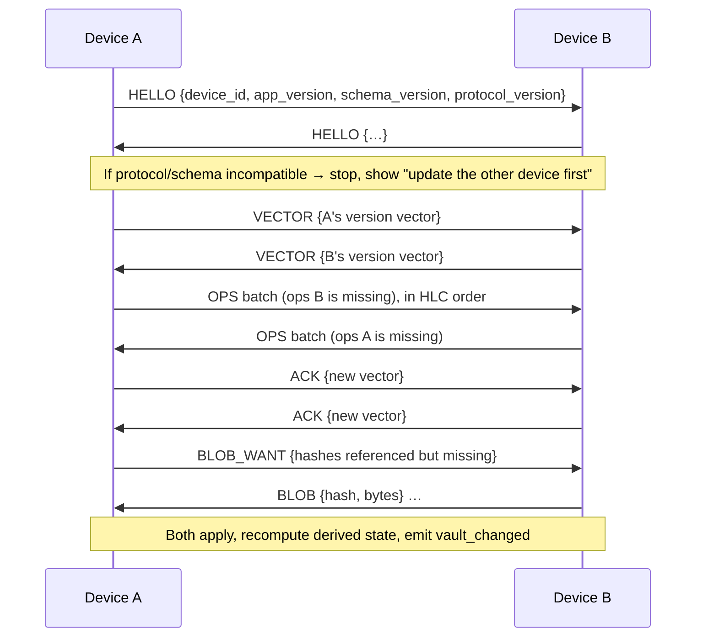

# 05 · Sync specification

> **Human-owned.** This is the hardest and most dangerous part of BioVault: a bug here is silent data loss. AI agents can help write it; you design and review every line, and nothing merges without the simulator passing (D69, D77).

## Requirements (D45, D46, D51, D53, D69)

1. Two (later possibly more) **equal peers**; each holds the full vault and works fully offline.
2. Sync happens **only on the local network**, over any mix of Ethernet and Wi-Fi on the same router. No relays, no cloud, no VPN.
3. **Zero lost edits**; no duplicates; both devices converge to the same state.
4. Merge rules exactly as decided: latest edit wins per field; links and category memberships combine; concurrent edits of *your text* keep both versions for you to resolve; deletions go to Trash.
5. Incompatible versions never half-sync.

## Concepts

### Hybrid logical clock (HLC)
Each device keeps an HLC: `(physical_ms, counter, device_id)`. It's always ≥ the wall clock, increases monotonically, and on receiving a remote stamp jumps ahead of it. Total order: compare physical, then counter, then device_id. This orders events sensibly even if a device's clock is off.

### Operation
Every mutation in `vault` becomes one operation:

```
Op {
  id:        hlc                 // unique and ordered
  entity:    kind + uuid
  action:    create | set_field | add_member | remove_member | delete | restore | append
  field:     optional field name
  value:     json
  base:      optional op id      // for text fields: the version this edit started from
}
```

Ops are stored in `op_log` and applied to tables in HLC order. Applying the same op twice has no effect (idempotent). **The op log is kept in full** — no compaction in v1 (my call): at the target scale it stays small, and the timelapse replays it (D74).

**Ops are recorded from the very first build of Phase 1**, even though sync arrives in Phase 2 — so the vault you build on desktop syncs without any migration.

### Version vector
For each known device: the highest HLC seen from it. Comparing vectors tells each side exactly which ops the other is missing.

## Merge rules per data type

| Data | Rule | Detail |
|---|---|---|
| Scalar fields (title edits, link type/note, category name/parent, lead status, position, settings) | **Last writer wins** by HLC | Deterministic on both sides |
| Your text (block `text` of takeaway, key result, note; link note) | **Keep both on concurrent edits** | An edit is concurrent if its `base` isn't the op it overwrote. The loser is kept as a **conflict version**; the block shows "2 versions — pick or merge". Nothing auto-blends text. |
| Category memberships, attachments on an owner | **Observed-remove set** | Add + remove both recorded; a remove only removes the adds it had seen, so a concurrent add survives |
| Links | Created by `create`; removed by `delete` (→ Trash) | Duplicate two-way links are prevented by normalized pairs; if two devices create the same pair concurrently, keep the earlier, mark the later as merged |
| Category tree moves | LWW on `parent_id` + **cycle check at apply time** | If applying a move would create a cycle, skip it (deterministic on both devices, so they agree) |
| Map positions | LWW | Recorded only on settle/drag to avoid flooding the log |
| Deletion | `delete` sets `deleted_at`; `restore` clears it; LWW between them | Edits to a deleted item still apply (so restore brings back the latest content) |
| Purge | Local, after 30 days from the delete op's HLC | Purge is not an op; both devices reach the same result independently. A purged entity leaves a **tombstone** (id + purged flag) so later-arriving ops for it are ignored |
| Suggestion events | Append-only | No conflicts possible |
| Fingerprints | Derived data keyed by `(node, model, content_hash)` | Identical on both sides; dedupe |
| Derived paper status | Recomputed locally after applying ops | Never synced as a decision |

## Discovery & pairing

**Discovery:** each running app advertises an mDNS/DNS-SD service `_biovault._tcp.local` with its device id and port. On Android the app first needs the runtime permission `ACCESS_LOCAL_NETWORK` ("Nearby devices"): from Android 17 (target SDK 37) every LAN packet, mDNS and TCP alike, is blocked without it. Ask for it before the first discovery; if it's denied, sync can't run, so say so and show where to grant it. While discovering, the app also holds a multicast lock (D85). **Fallback:** enter `ip:port` manually (for routers that block multicast) (F19).

**Pairing (once per device pair):**
1. Desktop → Settings → Devices → **Pair a phone**: generates a one-time pairing token and shows a QR containing `{device_id, name, address:port, public_key_fingerprint, token}`.
2. Phone scans → connects → both run an authenticated key exchange using the token.
3. Both screens show the same **6-digit confirmation code**; you confirm on both.
4. Each stores the other's long-term public key in `devices`.

**Sessions:** mutually authenticated and encrypted using the stored keys. My call: the **Noise protocol** (`snow` crate, XX/IK pattern) over TCP; acceptable alternative: TLS with pinned self-signed certificates (`rustls`). Either way: unknown devices are rejected.

## Protocol



- Batches are bounded (e.g. 1,000 ops) and resumable: a dropped connection just restarts from the new vectors.
- **Blobs** (screenshots, PDFs, model files) transfer separately by content hash after ops; an op referencing a missing blob is applied, and the UI shows a placeholder until the blob arrives.
- **Model files** (your link model, D70) sync as blobs plus a `model_registry` op naming the active version; both devices switch only when the file is present and verified.

## Versioning (D75, F26)

Three numbers travel in `HELLO`:
- **protocol_version** — message format; must match exactly.
- **schema_version** — database schema; devices sync only when equal (migrations run at startup, so updating both apps aligns them).
- **app_version** — informational.

## Conflict resolution UX (F-23)
- A block with a conflict shows both versions side by side: **Keep A / Keep B / Edit merged**.
- Open conflicts are counted in Stats → Sync health. Nothing else is blocked by an open conflict.

## The sync simulator (mandatory, D69)

A Rust test crate `sync-sim` that runs 2–3 in-memory devices:

1. Generate random sequences of realistic edits (create papers, edit takeaways, link, move categories, delete/restore) on each device while "offline".
2. Randomly sync pairs, including interrupted syncs and out-of-order delivery.
3. **Assert after full sync:**
   - all devices have identical vault state (byte-identical canonical JSON export);
   - no op is lost; every concurrent text edit exists either as the winner or as a conflict version;
   - no duplicate entities; no category cycles;
   - re-applying all ops is a no-op (idempotence).
4. Property-based (e.g. `proptest`), thousands of runs locally (and in CI if you set it up); any failing seed is saved as a regression test.

**Gate:** Phase 2 isn't done, and no sync change ships, unless the simulator passes.
