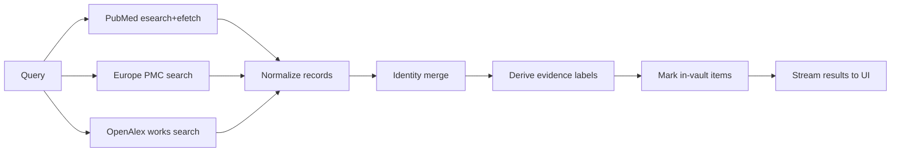

# 06 · Sources & search

## The sources (D23, D24, D26, D29)

| Source | Used for | Access | Etiquette / limits |
|---|---|---|---|
| **PubMed** (NCBI E-utilities) | Search with PubMed's own behavior (ranking, MeSH queries); records with publication types and MeSH | Free; API key optional | Send `tool` + `email`; ≤3 requests/s without a key, ≤10/s with one |
| **Europe PMC** (REST API) | Life-science search incl. **preprints**; open-access full text links; withdrawn-preprint flags | Free | Be polite; cache |
| **OpenAlex** | All-fields search (beyond biomedicine), **topics** hierarchy, **references** (citations), DOI lookups | Free API key required (since Feb 2026); daily free usage allowance; single-record lookups by DOI/ID free | Cache aggressively; lookups preferred over searches (see risk R-08) |
| **Crossref** | DOI metadata fallback; **retraction/correction status** (includes Retraction Watch data) | Free | Use the "polite pool" with a `mailto` |
| **Unpaywall** | Best legal free copy for a DOI (`Read` button) | Free | `email` parameter |
| Google Scholar | **Not an in-app source** — no official API, terms forbid automated access | — | "Open in Google Scholar" button only (D29) |
| ClinicalTrials.gov | Link-out from trial numbers on papers (P1); searchable source parked (P4) | — | — |
| OpenFDA | Not searchable; save pages as user-added links (D23) | — | — |

All clients live in the core's `sources` module: rate-limited per source, retried with backoff, and cached in `api_cache` (my call: search results 24 h, record lookups 30 days, Unpaywall 7 days).

## Search flow (F-01)

- Fan-out in parallel; stream each source's results as they arrive; merge incrementally. First 25 per source, then "Load more" (my call).
- On save, the full record is fetched from every source that has it, so the paper's details and labels are as complete as possible; a "Refresh details" action repeats this on demand.
- Ranking (my call): interleave by each source's own rank, boosted when several sources agree; papers already in the vault are marked, not hidden.
- Source chips: All · PubMed · Europe PMC · OpenAlex.
- Filters: year range, study type, species, peer-reviewed only, hide retracted.

## Identity merge (D71)

Every record is normalized to one identity before display:

1. **DOI** (lowercased, `https://doi.org/` stripped)
2. else **PubMed ID**
3. else **PMC ID**
4. else **OpenAlex ID**
5. else **fuzzy match**: normalized title (lowercase, punctuation stripped) + year (±1) + first author surname

Records sharing any of 1–4 are the same paper; their fields are combined (prefer PubMed for MeSH/pub types, OpenAlex for topics/references, Europe PMC for preprint status, Crossref for retraction status). A fuzzy match (5) is merged only in results display, never automatically inside the vault — on save, a likely duplicate prompts "Is this the same as …?"

The same identity rules dedupe **add by identifier** (F-03) against the vault.

## Evidence labels (D24, D25, F11)

Derived in the core's `labels` module; anything uncertain shows **unknown**, never a guess.

| Label | Derived from |
|---|---|
| Study type | PubMed publication types (e.g. Randomized Controlled Trial, Meta-Analysis, Systematic Review, Clinical Trial, Observational Study, Case Reports, Review); OpenAlex/Europe PMC type as fallback |
| Species | MeSH check tags *Humans* / *Animals* (both → mixed); *In Vitro Techniques* and related MeSH → in vitro; otherwise unknown |
| Peer review | Preprint if from a preprint server (Europe PMC preprint source / OpenAlex type); peer-reviewed if published in a journal; else unknown |
| Year | Publication date |
| Retraction / correction | Crossref update relations (retraction, correction, expression of concern); PubMed "Retracted Publication"; Europe PMC withdrawn/removed preprints |
| Sample size | **n/a** unless the bring-your-own-model connector is enabled (P3); then extracted from the abstract and marked "extracted by model" |

Feed defaults (P3) are stricter (peer-reviewed only) than search (everything, labeled) (D24).

**Retraction alerts (P3, F-32):** a background check, at most weekly per paper (my call), re-queries Crossref (DOI lookup) and PubMed for saved papers; a status change shows a banner on the paper and a note in the Inbox.

## Category suggestions (D31)

For a paper being processed:
1. Collect candidate signals: its OpenAlex topics (with subfield/field), its MeSH major headings.
2. If a **learned mapping** exists (topic or MeSH term → your category), suggest that category first, ranked by how often you've used the mapping.
3. Otherwise show the raw topic/term names as "create category?" suggestions, placed under the closest existing parent if one matches.
4. Your choice updates the mapping table. Nothing is assigned without your action.

## Add by identifier (F-03)

Recognized inputs: bare DOI (`10.…`), `doi.org/…`, PMID (digits), `PMC…`, PubMed/Europe PMC/OpenAlex/publisher URLs containing a DOI. Lookup order: OpenAlex by DOI (free) → PubMed by PMID → Crossref by DOI → Europe PMC. No identifier → manual form, `details_verified = false`.

## Privacy note (F23)
Search queries and paper lookups are sent to NCBI, EBI, OpenAlex, Crossref and Unpaywall. They see what you search, never your vault, findings or takeaways. No other network traffic except LAN sync.

## Sources consulted for this blueprint
- Europe PMC overview (NAR 2024): https://academic.oup.com/nar/article/52/D1/D1668/7442539
- OpenAlex API keys & usage-based pricing (Feb 2026): https://groups.google.com/g/openalex-users/c/6kwRTtqUcnU · https://www.casrai.org/guides/openalex-api
- OpenAlex topics hierarchy: https://help.openalex.org/hc/en-us/articles/24736129405719-Topics
- NCBI E-utilities usage guidelines: https://www.ncbi.nlm.nih.gov/books/NBK25497/
- Crossref & Retraction Watch: https://crossref.org/documentation/retrieve-metadata/retraction-watch/
- Google Scholar API status: https://www.casrai.org/dictionary/term/google-scholar-api
