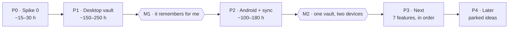

# 10 · Roadmap

**No dates, no rush (D76).** The plan is expressed in phases, milestones and rough hours of work. Hours are for one developer learning Rust along the way; heavy use of AI coding agents (D77) will likely bring them down — except for the human-owned parts.

## Phase 0 — Spike 0 (~15–30 h)
Throwaway; prove the risky parts ([04](04-architecture.md#spike-0--prove-the-risky-parts-first-d68)).
- [ ] Tauri + React app runs on Windows and installs on Android
- [ ] SPECTER2 (8-bit ONNX) fingerprints one abstract on the phone in ≤ 2 s; engine chosen (ort / tract); model size noted
- [ ] Phone discovers desktop on the LAN (Ethernet ↔ Wi-Fi) and exchanges an encrypted message
- [ ] PixiJS: 1,000 dots / 3,000 lines smooth in the Android WebView
- **Exit:** all pass → P1. Interface fails badly → Flutter for the UI, Rust core unchanged.

## Phase 1 — Desktop vault (~150–250 h) → **M1 "it remembers for me"**
Suggested build order (each step usable on its own):

| Step | Work | Features |
|---|---|---|
| 1.1 | Repo, core skeleton, SQLite schema + migrations, **op log recording from day one** (so P2 sync works on existing data) | — |
| 1.2 | Source clients (PubMed, Europe PMC, OpenAlex, Crossref, Unpaywall) with fixtures; identity merge; evidence labels | F-01 (core) |
| 1.3 | Search UI, save to Inbox, add by identifier, paper page, Read button, Scholar button | F-01, F-02, F-03, F-05 |
| 1.4 | Findings as block stacks, processing, categories + suggestions + learned mappings, derived status | F-04, F-06, F-09 |
| 1.5 | Typed links, leads, attachments | F-07, F-08 |
| 1.6 | SPECTER2 on desktop, keyword + meaning vault search, "related" prompt, **decision logging** | F-10, F-11 |
| 1.7 | Map renderer: layout worker, stable positions, layers, focus mode, Tidy up | F-12 |
| 1.8 | Trash, export (JSON/Markdown/BibTeX-RIS) + JSON import, Stats, settings & first run | F-13…F-16 |

**M1 test:** for two weeks, every paper you read goes through BioVault instead of phone notes or paper. Stats show what share got processed.

> It's fine to stay on M1 for months. The desktop vault alone delivers most of the value.

## Phase 2 — Android + sync (~100–180 h) → **M2 "one vault, two devices"**

| Step | Work | Features |
|---|---|---|
| 2.1 | **Sync simulator first** (test-first): HLC, version vectors, merge rules against simulated devices | F-22 (core) |
| 2.2 | Android build: phone layouts, Inbox home, phone map | F-20 |
| 2.3 | Discovery, QR pairing, encrypted sessions, manual-address fallback | F-21 |
| 2.4 | Real protocol over the network; blob transfer; version check | F-22, F-24 |
| 2.5 | Conflict resolution UI; sync health in Stats; signing key + release APK | F-23, F-25 |

**M2 test:** a week of daily use on both devices with zero lost or duplicated edits; simulator green.

## Phase 3 — Next (in this order, D77)

| # | Feature | Rough hours |
|---|---|---|
| 1 | Timelapse button (F-30) | 10–20 |
| 2 | Topic feed with "why" + retraction alerts (F-31, F-32) | 40–70 |
| 3 | Suggestion layer + keyword hubs (F-33) | 20–40 |
| 4 | Your own link model (F-34) — when ~200 links / ~300 decisions exist | 30–60 |
| 5 | Sketching (F-35) | 30–50 |
| 6 | In-app open-access reader + your own PDFs (F-36) | 40–80 |
| 7 | Bring-your-own-model connector (F-37) | 15–30 |

## Phase 4 — Later (parked, D56)
Path view · timeline layout · ClinicalTrials.gov as a searchable source · custom link types · highlight-to-finding in PDFs.

## Working with AI agents (D77)

- **Agent-ready by design:** every feature in [02](02-features-and-flows.md) has "done when" criteria; hand agents one step at a time with the relevant doc sections.
- **Human-owned** (agents assist; you design, review every line, and must understand it):
  1. Sync merge rules, conflict detection, the simulator's assertions ([05](05-sync-spec.md)).
  2. Link-model features, evaluation protocol and the replace-or-not decision ([08](08-ml.md)).
  3. The rule that AI never writes a takeaway (enforced in core).
- **Guardrails:** core tests + simulator must pass before merging; no new dependency without a license check (D63).

## Open items (deliberately left for later)

| Item | Status |
|---|---|
| Visual design / identity | Yours to design; brief in [07](07-map-and-interface.md#design-brief) (D60) |
| Importing existing phone/paper notes | Not planned; add manually (my call) |
| Importing a Zotero/BibTeX library | Not in v1; candidate for P4 (my call) |
| Preprint → published version | Offer to merge when the published version appears; build alongside retraction alerts in P3 (my call) |
| Feed cadence, caps, notification style | Decide when building F-31 |
| Text recipe for fingerprinting findings | Settle with the reader evaluation set ([08](08-ml.md)) |
| Going public | Requires: final name check (F22), per-user API keys, iOS decision, a short privacy note |
