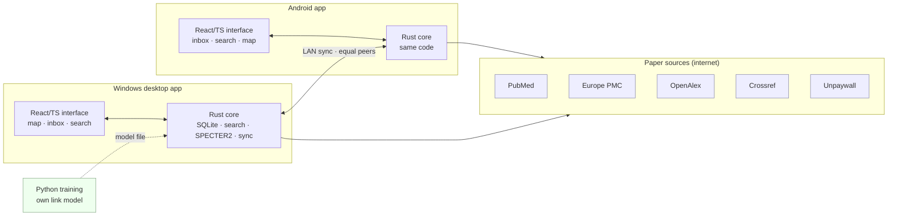

# BioVault — Project Blueprint

**Status:** Blueprint v1.1 · 2026-11-24 · written from a 13-round design interview; v1.1 adds the repo-setup decisions D80–D83
**Owner:** Nikos (karagionikos) · **License:** source-available, all rights reserved (see [ADR-007](decisions/ADR-007-source-available.md))

BioVault is a personal research vault for life-science and health research. It runs as one app on a Windows desktop and an Android phone, works fully offline, syncs the two devices over the home network, and turns the papers you read into an evolving, categorized **personal evidence map**: papers, the findings you took from them, and the typed connections between them.

> Research only. BioVault organizes what published research says; it never tells anyone what to do.

## How to read this blueprint

| # | Document | What it answers |
|---|---|---|
| 00 | [Overview](00-overview.md) | What BioVault is, the principles, the glossary |
| 01 | [Vision & scope](01-vision-and-scope.md) | Why it exists, who it's for, goals / non-goals / anti-goals, success measures |
| 02 | [Features & flows](02-features-and-flows.md) | Every feature by phase with "done when" criteria; the main user flows and screens |
| 03 | [Data model](03-data-model.md) | Entities, fields, identity, timestamps, deletion |
| 04 | [Architecture](04-architecture.md) | Tauri 2 + Rust core + React/TS; modules; boundaries; Spike 0 |
| 05 | [Sync specification](05-sync-spec.md) | Peer-to-peer LAN sync: discovery, pairing, protocol, merge rules, tests |
| 06 | [Sources & search](06-sources-and-search.md) | PubMed, Europe PMC, OpenAlex, Crossref, Unpaywall; identity merge; evidence labels; category suggestions |
| 07 | [Map & interface](07-map-and-interface.md) | Own map renderer, layers, stable layout, timelapse, phone behavior, design brief, sketch canvas |
| 08 | [Machine learning](08-ml.md) | SPECTER2 on-device, the v1 "related" score, decision logging, your own link model, BYO-model connector |
| 09 | [Testing & release](09-testing-and-release.md) | Test layers, sync simulator, builds, signing, versioning, repo layout |
| 10 | [Roadmap](10-roadmap.md) | Phases 0–4, milestones M1/M2, hour estimates, open items |
| 11 | [Risks](11-risks.md) | Risk register with mitigations |
| — | [Decision log](decision-log.md) | Every decision, numbered D1–D83 (D1–D79 from the interview, D80–D83 from repo setup) |
| — | [Decision records](decisions/) | Short ADRs for the ten decisions that shape everything else |

## The design in one diagram

## Conventions used in these docs

- **Decision references** like *(D45)* point to the [decision log](decision-log.md).
- **"My call"** marks a choice made by the blueprint author where the interview left room; each is easy to revisit.
- **Phases:** *P0* Spike 0 · *P1* desktop vault · *P2* Android + sync · *P3* "Next" · *P4* "Later".
- **Human-owned** marks parts where AI agents may assist but the design and every line of review stay with you (sync merge logic, link-model evaluation).
